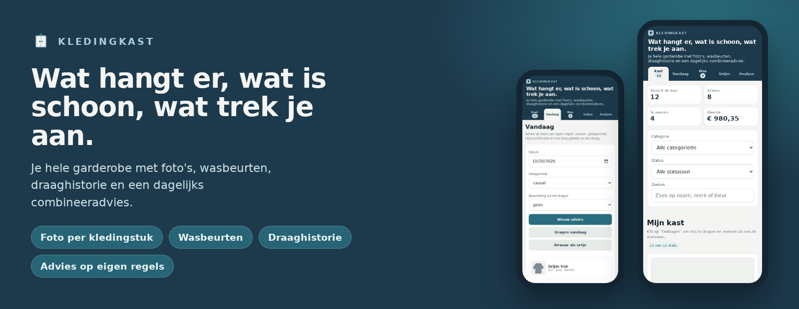
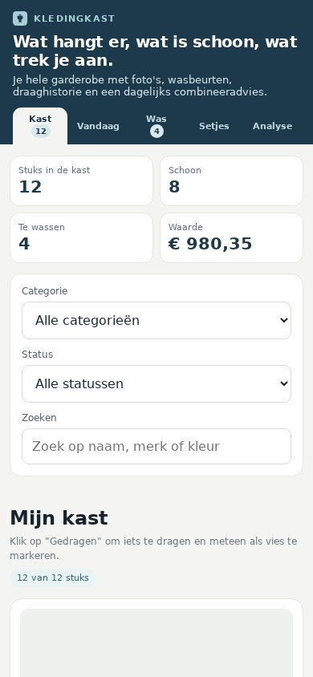
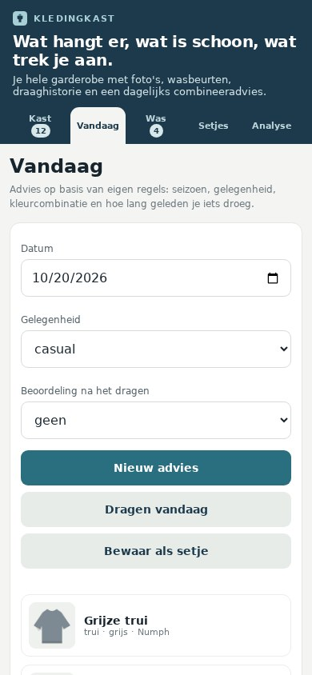
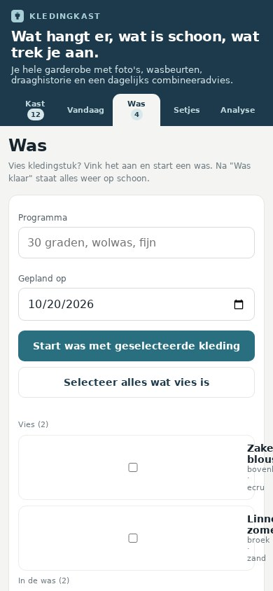
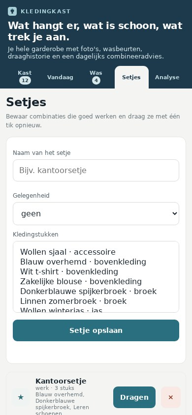
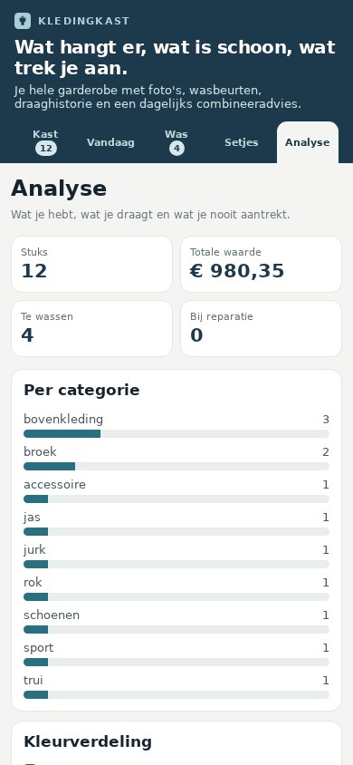
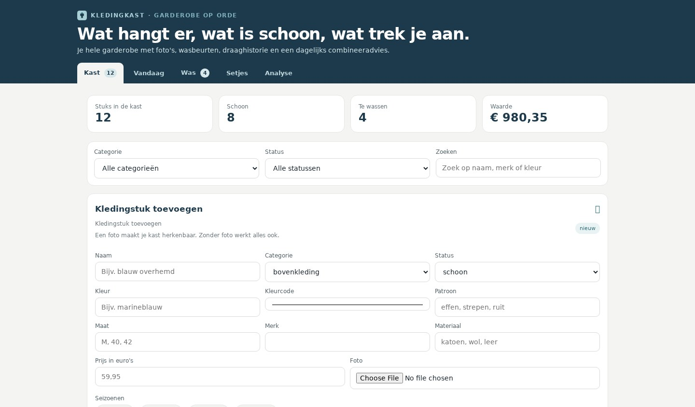
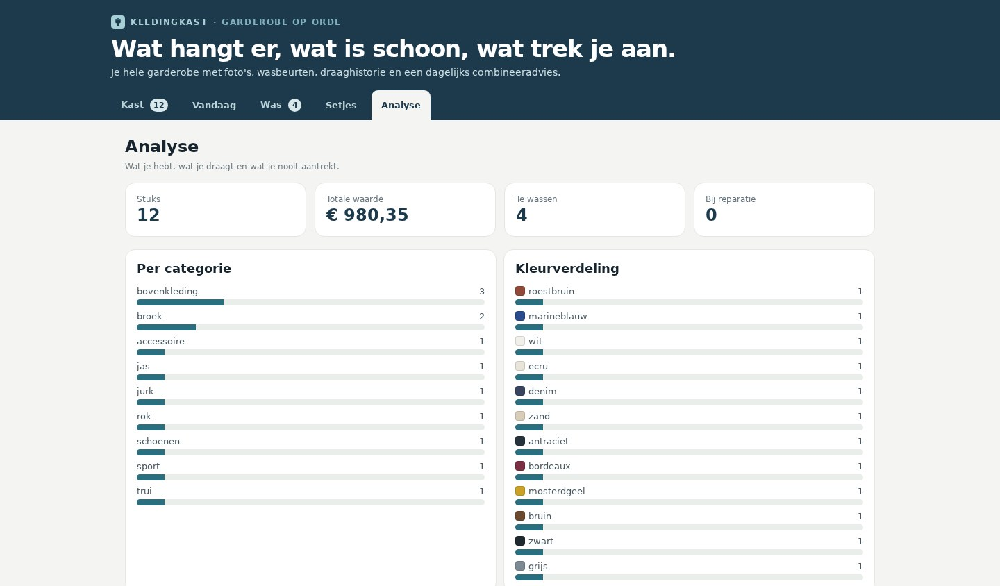

# Kledingkast → samengevoegd met VoorraadThuis

> **Deze repository is gearchiveerd.** De garderobe is samengevoegd met **[VoorraadThuis](https://github.com/Theberas04/voorraadthuis)** en is daar nu een tab in dezelfde app: één service, één database, één installatie op Proxmox.
>
> 👉 **https://github.com/Theberas04/voorraadthuis**

Installeren op Proxmox doe je vanaf VoorraadThuis:

```bash
bash <(curl -fsSL https://raw.githubusercontent.com/Theberas04/voorraadthuis/main/deploy/proxmox/install.sh)
```

## Wat er veranderd is

- De garderobe draait in dezelfde Node.js-service als VoorraadThuis; de API staat onder `/api/kast/*` en kledingfoto's onder `/media/`.
- De webpagina heeft er een tab **Kleding** bij gekregen met dezelfde onderdelen als deze app: **Kast**, **Vandaag**, **Was**, **Setjes** en **Analyse**, in de huisstijl van VoorraadThuis.
- De foto's staan in de LXC in `/var/lib/voorraadthuis/fotos`; kleding, wasbeurten en draaghistorie zitten in dezelfde SQLite-database (`/var/lib/voorraadthuis/voorraad.db`).
- Alle functies zijn behouden: status per kledingstuk, combineeradvies op eigen regels met beweegredenen, wasbeurten plannen en afronden, setjes bewaren, draaghistorie per maand, analyse met prijs per keer dragen, en optionele AI-tagging van een foto.

De geschiedenis hieronder beschrijft de zelfstandige versie zoals die was.

---

# Kledingkast (archief)



[](https://nodejs.org/)
[](test/app.test.js)
[](package.json)
[](public/manifest.webmanifest)
[](deploy/proxmox/README.md)
[](LICENSE)

Je garderobe op één plek, in het Nederlands en volledig op je eigen hardware: foto's per kledingstuk, wasbeurten, draaghistorie en een dagelijks combineeradvies. Eén Node.js-service met SQLite, geen npm-dependencies, geen Docker, geen account — en te installeren op een Proxmox LXC met één commando.

## Op de telefoon

| Mijn kast | Vandaag | Was | Setjes | Analyse |
| --- | --- | --- | --- | --- |
|  |  |  |  |  |

- Vijf navigatieknoppen op één rij, ook op een scherm van 360 px breed.
- De kastlijst staat direct onder de filters; het toevoegformulier klapt dicht op een smal scherm.
- Foto's maken vanaf de telefoon met de camera-knop in het formulier.
- Installeerbaar als app: kies **Toevoegen aan startscherm** (iOS) of **App installeren** (Android). Daarvoor is HTTPS nodig; de Proxmox-installatie zet dat zelf op.

<details>
<summary>Schermafbeeldingen op desktop</summary>

| Mijn kast | Analyse |
| --- | --- |
|  |  |

</details>

> De schermafbeeldingen gebruiken een demodata-set met getekende kleding-illustraties in plaats van foto's, zodat er geen echte kleding te zien is.

## Wat het doet

- **Kast**: kledingstukken met naam, categorie, kleur (met kleurcode), patroon, maat, merk, materiaal, seizoenen, gelegenheden, prijs, notities en foto. Filter op categorie of status en zoek op naam, merk, kleur of notitie.
- **Status per stuk**: schoon, vies, in de was of bij reparatie. Alles in één oogopslag, met tellers in de navigatie.
- **Vandaag**: een combineeradvies voor de gekozen dag en gelegenheid, met uitleg waarom die combinatie past. Met één knop registreer je het als *gedragen*; dat stuk gaat dan op vies. Je kunt het advies ook als setje bewaren.
- **Was**: vies kleding bij elkaar vinken, een was starten met programma en datum, en met **Was klaar** staat alles weer op schoon. Een was annuleren zet de kleding terug op vies.
- **Setjes**: vaste combinaties bewaren en in één tik opnieuw dragen; ze verschijnen ook in de draaghistorie.
- **Analyse**: aantal per categorie, kleurverdeling, meest gedragen, nooit gedragen, te wassen, prijs per keer dragen en de totale waarde van je kast.
- **Draaghistorie**: maandkalender met wat je per dag droeg, inclusief beoordeling en notitie.

### Hoe het advies werkt

Het advies komt uit eigen, uitlegbare regels — geen taalmodel en geen internetverbinding nodig:

1. Alleen kledingstukken met status **schoon** komen in aanmerking.
2. Per gelegenheid hoort een vaste opbouw: bijvoorbeeld werk vraagt om bovenkleding of een jurk met een broek of rok, schoenen en in het koude seizoen een jas.
3. Seizoenen en gelegenheden die je per stuk hebt aangegeven wegen mee; kleding die daar niet bij past valt af.
4. Kleurharmonie: rustige basiskleuren mogen overal bij, één accentkleur is prima, twee verwante tinten mogen, twee felle kleuren krijgen straf.
5. Wat je de laatste drie dagen droeg krijgt straf, zodat je niet steeds hetzelfde advies krijgt; zelden gedragen kleding krijgt een kleine voorkeur.

Elke uitkomst toont de gebruikte argumenten, zodat je zelf kunt zien waarom een setje wordt voorgesteld. Met **Nieuw advies** vraag je een volgende goede combinatie op.

### AI-tagging (optioneel, standaard uit)

Heb je een OpenAI-compatibele dienst (OpenAI, Ollama, LocalAI), dan kan Kledingkast een foto zelf lezen en naam, categorie, kleur, patroon, materiaal en seizoen invullen. Zet daarvoor `AI_BASE_URL`, `AI_API_KEY` en `AI_VISION_MODEL`; zonder die instellingen is de knop **Foto lezen** verborgen en werkt de app volledig handmatig. Wat je zelf invult is altijd leidend.

## Waar je gegevens stonden

| Pad in de LXC | Inhoud |
| --- | --- |
| `/var/lib/kledingkast/kledingkast.db` | Kleding, setjes, draaghistorie en wasbeurten (SQLite). |
| `/var/lib/kledingkast/fotos/` | De geüploade foto's, één bestand per kledingstuk. |

In de samengevoegde app staat dit in `/var/lib/voorraadthuis/voorraad.db` en `/var/lib/voorraadthuis/fotos/`.

## API van deze versie

| Route | Doet |
| --- | --- |
| `GET /api/config` | Categorieën, statussen, seizoenen, gelegenheden en of AI-tagging aanstaat. |
| `GET/POST /api/items`, `GET/PATCH/DELETE /api/items/<id>` | Kledingstukken lezen, toevoegen, aanpassen en verwijderen; `PATCH` met `action: analyze` laat een foto lezen. |
| `POST /api/photos`, `GET /media/<bestand>` | Foto uploaden (JPEG, PNG of WebP) en terugkrijgen. |
| `GET /api/suggest?occasion=&date=&seed=` | Combineeradvies met beweegredenen. |
| `GET/POST /api/wear`, `DELETE /api/wear/<id>` | Dragen registreren, historie per maand en een registratie wissen. |
| `GET/POST /api/washes`, `PATCH/DELETE /api/washes/<id>` | Wasbeurten plannen, afronden of annuleren. |
| `GET/POST /api/outfits`, `DELETE /api/outfits/<id>` | Setjes bewaren en verwijderen. |
| `GET /api/analytics` | Totalen, kleurverdeling, meest en nooit gedragen, prijs per dracht. |

In VoorraadThuis staan deze routes onder `/api/kast/`.

## Herkomst en licentie

Deze app is geschreven voor Tom Werdens, geïnspireerd op het idee achter [wardrowbe](https://github.com/Anyesh/wardrowbe) (MIT) — een self-hosted garderobe-app met AI-tagging. Kledingkast is een eigen implementatie: andere stack (Node.js + SQLite in plaats van FastAPI + PostgreSQL + Redis), Nederlandse interface, alles in één service, en combineeradvies op eigen regels in plaats van een taalmodel. Er is geen code uit dat project overgenomen.

De broncode valt onder de [MIT-licentie](LICENSE).
